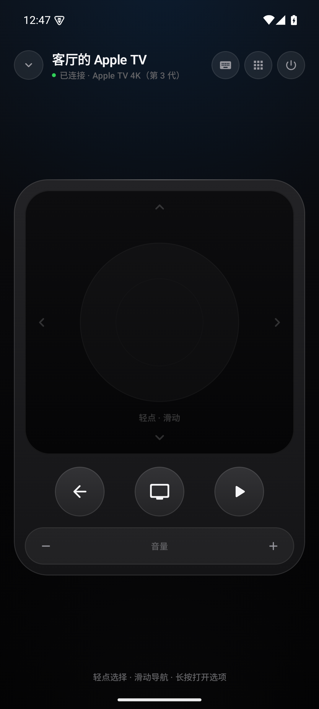
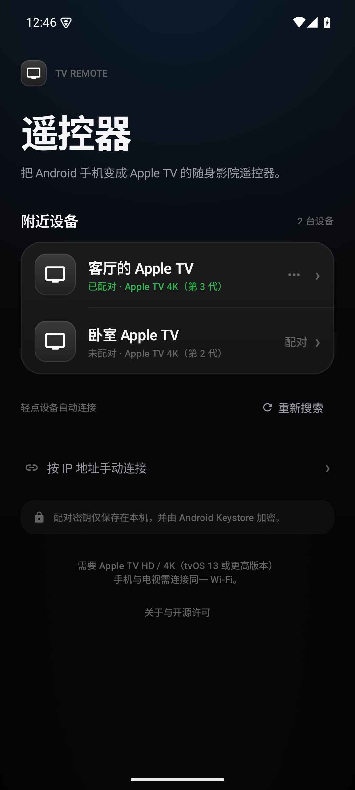
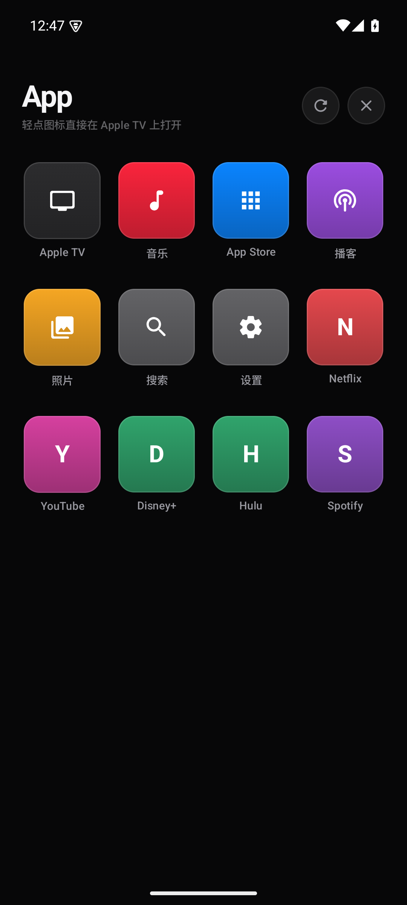
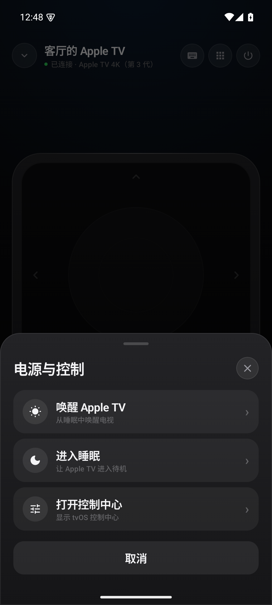
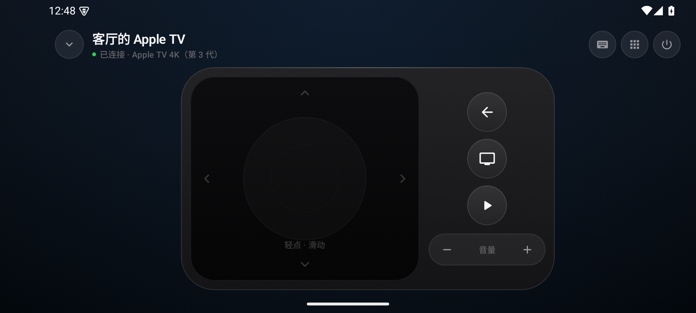

# TV Remote · Android 原生 Apple TV 遥控器

一个用 **Kotlin + Jetpack Compose** 编写的 Android 原生 Apple TV 遥控器。界面参考 iOS 原生 Apple TV 遥控器 / Siri Remote：近黑色背景、触控板、圆形返回 / TV / 播放键，以及克制的玻璃质感按钮。

它直接使用 Apple 的 **Companion Link** 协议与局域网内的 Apple TV 通信，不需要中转服务器、云端账号或 Python 环境。配对凭证由 Android Keystore 加密后保存在本机。

> 本项目与 Apple Inc. 无关联。“Apple”“Apple TV”“AirPlay”“Siri”是 Apple Inc. 的商标，此处仅用于说明兼容性。

## 界面

| 遥控器 | 设备发现 |
| --- | --- |
|  |  |

| App 启动器 | 电源控制 |
| --- | --- |
|  |  |

横屏会自动切换成更适合手持的横向遥控器布局：



## 功能

- **mDNS 自动发现** Apple TV（`_companion-link._tcp`）
- **4 位 PIN 配对**，配对握手成功后自动连接
- **Siri Remote 风格触控板**
  - 轻点中心 = 选择
  - 滑动 = 连续方向 / 滚动，带指针加速度曲线
  - 轻点边缘 = 上 / 下 / 左 / 右
  - 长按 = 打开上下文菜单
- 返回、主屏幕（长按主屏幕键 = 打开 tvOS 控制中心）、播放 / 暂停
- 音量 + / −（取决于 Apple TV 的 HDMI-CEC / 音量路由能力）
- 电源面板：唤醒、进入睡眠、打开控制中心
- **键盘输入**：电视上出现输入框时自动弹出手机键盘，实时同步到电视搜索框
- **App 启动器**：从 Apple TV 读取可启动 App 列表并直接启动
- 断线提示、重新连接、自动重新发现 Companion 端口
- Android Keystore 加密保存配对密钥
- 深色 / 横竖屏自适应 / 触感反馈

## 安装

1. 下载 [`dist/TVRemote-1.0.0.apk`](dist/TVRemote-1.0.0.apk) 并安装（需要允许“安装未知来源应用”）。
2. 手机和 Apple TV 连接到**同一个 Wi-Fi / 子网**。
3. 打开 App，轻点发现的 Apple TV。
4. 输入电视屏幕上显示的 4 位配对码。

首次配对时，电视上可能出现“是否允许此设备访问”的确认，请选择允许。配对完成后，下次打开 App 轻点设备即可直接进入遥控器。

## 环境要求

- Android 8.0（API 26）或更高版本
- Apple TV HD / Apple TV 4K，tvOS 13 及以上
- 手机和 Apple TV 在同一局域网；路由器不能开启 AP / 客户端隔离
- 如果自动发现不可用，可在设备页使用“按 IP 地址手动连接”

## 构建

需要 **JDK 21**、Android SDK Platform 35。

```bash
# macOS 上 Android Studio 自带的 JDK
export JAVA_HOME="/Applications/Android Studio.app/Contents/jbr/Contents/Home"
export ANDROID_HOME="$HOME/Library/Android/sdk"

./gradlew :protocol:test          # 协议单元测试
./gradlew :app:assembleDebug      # debug APK
./gradlew :app:assembleRelease    # 签名的 release APK
```

Release APK 输出在 `app/build/outputs/apk/release/app-release.apk`。

> 演示签名 key 不会进入 Git 仓库；如果本地没有 `keystore/tvremote.jks`，release 构建会自动回退到 debug 签名。正式发布时请生成自己的 keystore 并替换签名配置。已上传的 APK 使用演示 key 签名。

## 项目结构

```
app/                         Android UI、ViewModel、发现、存储
  ui/RemoteScreen.kt         iOS 风格遥控器 / 触控板 / 电源面板
  ui/DeviceListScreen.kt     设备发现与手动连接
  ui/PairingScreen.kt        4 位 PIN 配对
  ui/AppDrawer.kt            tvOS App 启动器
  ui/KeyboardPanel.kt        实时键盘输入
protocol/                    纯 Kotlin/JVM Companion Link 协议
  hap/                      HAP SRP-6a 配对、Curve25519 / Ed25519 验证
  crypto/                   HKDF、ChaCha20-Poly1305、SRP
  companion/                OPACK 帧、加密会话、HID 命令
  opack/                    Apple OPACK 序列化
  plist/                    键盘输入所需的二进制 plist
docs/screenshots/            界面截图
```

协议层不依赖 Android，可独立在桌面 JVM 上运行测试。

## 兼容性与限制

- Apple TV 3 及更早机型使用旧的 DMAP 协议，**不支持**。
- 音量的可用性取决于音响路由方式：如果 Siri Remote 通过红外直接控制音响，Apple TV 不在音量链路中，网络客户端无法调音量。
- 当前版本**没有**“正在播放”封面、Siri 语音、AirPlay 投屏和红外功能。
- Companion Link 是 Apple 未公开的协议，tvOS 更新可能改变其行为。协议实现参考了 pyatv 的公开逆向工程成果。
- 本机已用局域网中的 Apple TV 4K 实测 **mDNS 发现和配对流程（电视成功显示配对码）**；由于自动化环境无法读取电视屏幕上的 PIN，未能完成端到端按键验证。实际使用前请按上方步骤完成一次配对。

## 隐私与安全

- 没有账号、没有云同步、没有遥测。
- 配对密钥只写入本机 DataStore，并使用 Android Keystore 中的 AES-256-GCM 密钥加密。
- App 只连接你选择的 Apple TV 的局域网地址；不使用任何第三方分析 SDK。
- “关于与开源许可”中可查看完整第三方许可文本。

## 许可

本项目使用 MIT License，详见 [LICENSE](LICENSE)。

Companion Link 协议模块改编自 [CyberRemote](https://github.com/cyberhandyman/CyberRemote)（MIT），后者基于 [pyatv](https://github.com/postlund/pyatv)（MIT）的协议研究。完整声明见 [NOTICE.md](NOTICE.md) 和 App 内置的 `THIRD_PARTY_NOTICES.txt`。
